# Catatan Tugas – To-Do List React.js

Kuis Praktikum Pemrograman Web : Aplikasi To-Do List dengan React.js + Vite.
Data dummy dan dikelola dengan React State, sehingga setiap perubahan langsung tampil tanpa reload.

## Fitur
- Menampilkan daftar tugas (judul, status, prioritas, deadline)
- Melihat detail tugas di halaman `/todo/:id`
- Menambah tugas lewat formulir modal (dengan validasi)
- Mengubah tugas lewat formulir modal dari halaman detail
- Menghapus tugas dengan dialog konfirmasi
- Umpan balik berupa toast setelah tambah, ubah, dan hapus
- Filter status, pencarian judul, dan penanda deadline yang sudah lewat
- Responsif: tabel berubah menjadi kartu di layar kecil

## Struktur data tugas
```js
{ id: 1, title: '...', description: '...', priority: 'low | medium | high',
  deadline: 'YYYY-MM-DD', status: 'to-do | in progress | done' }
```

## Screenshot

### Daftar tugas


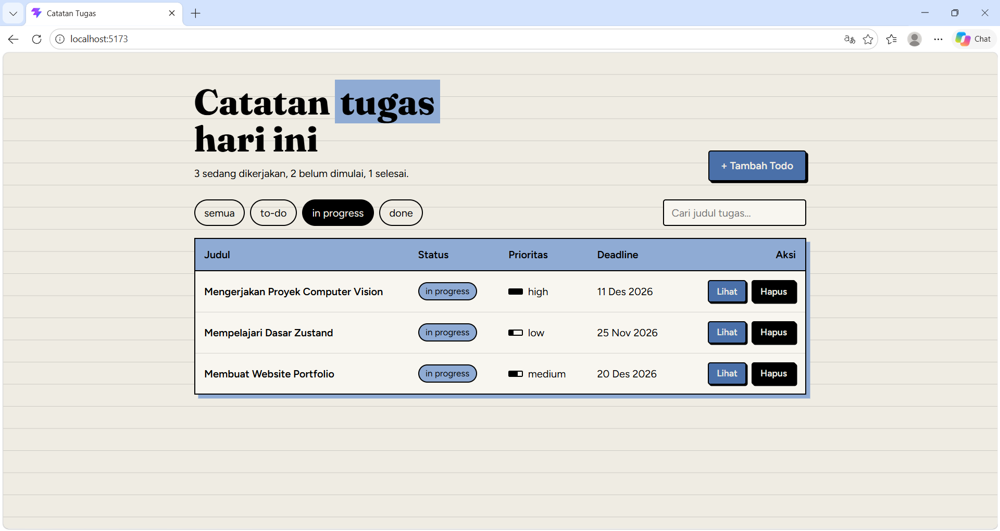
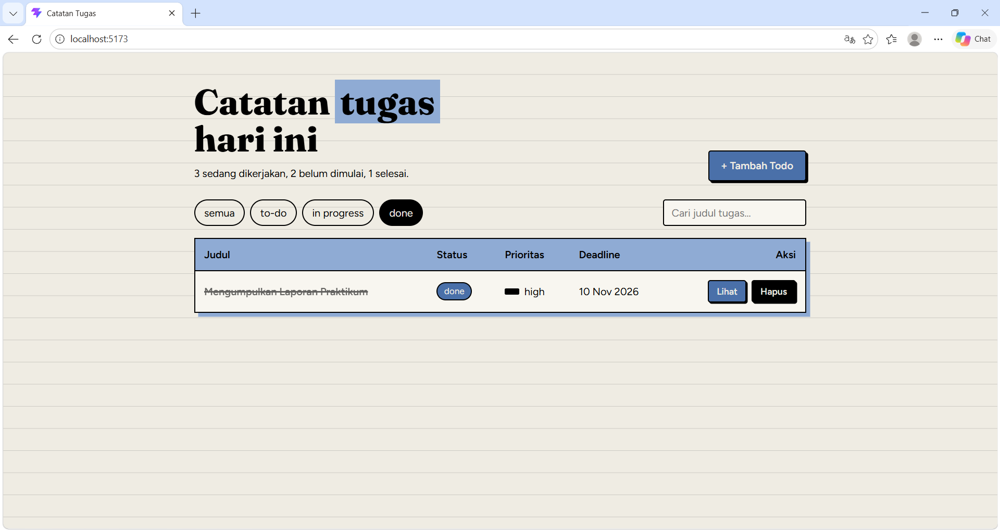

### Tambah tugas
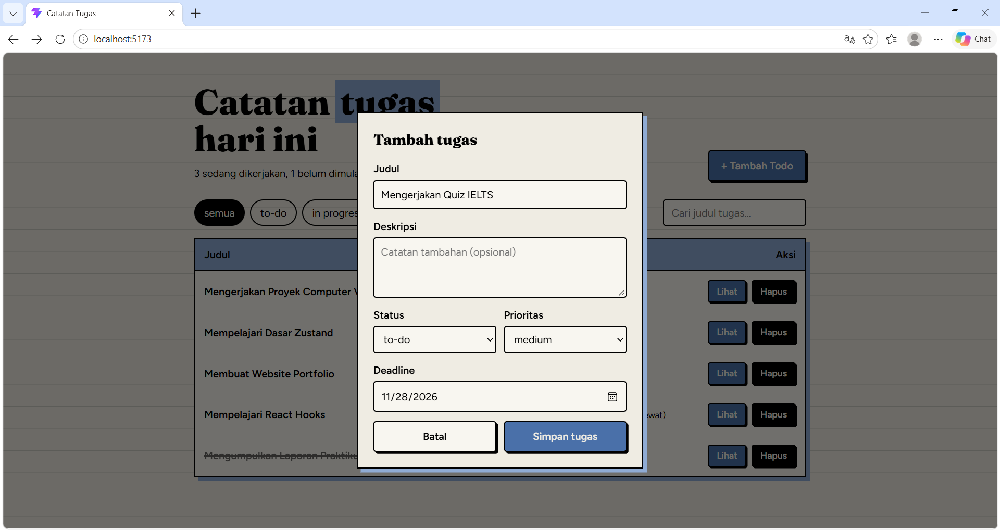

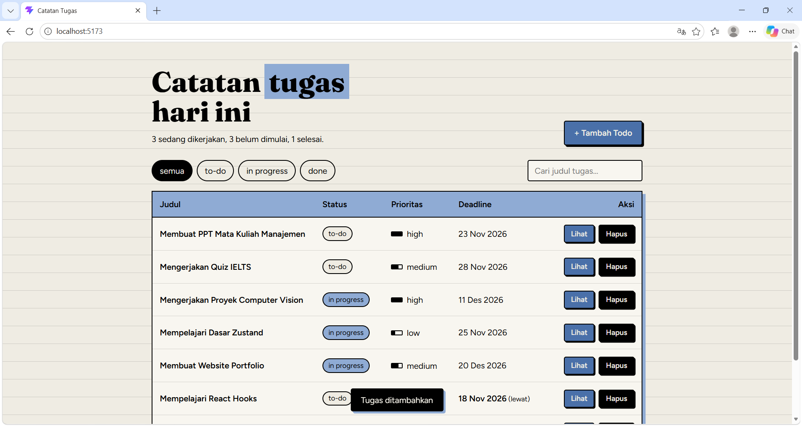

### Detail dan ubah tugas
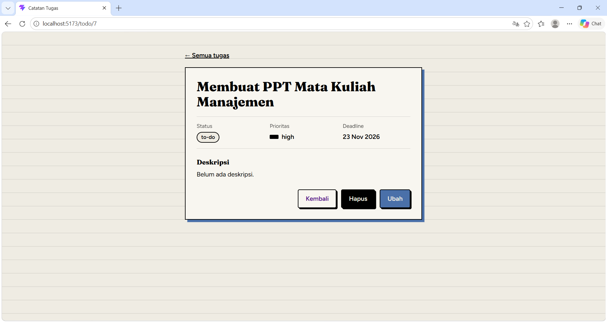
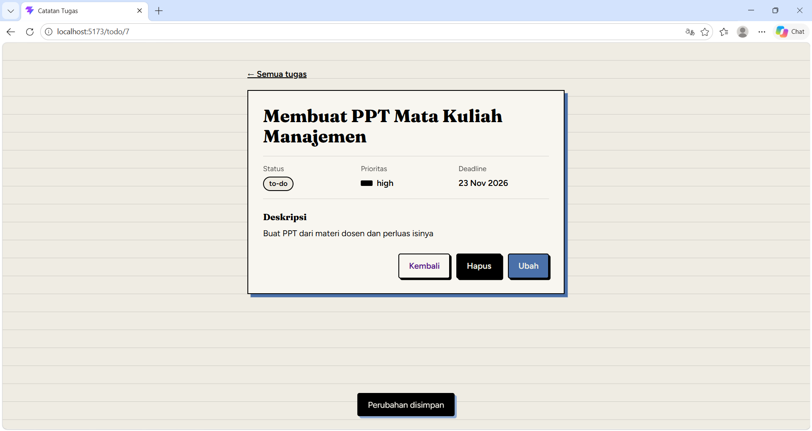

### Hapus tugas

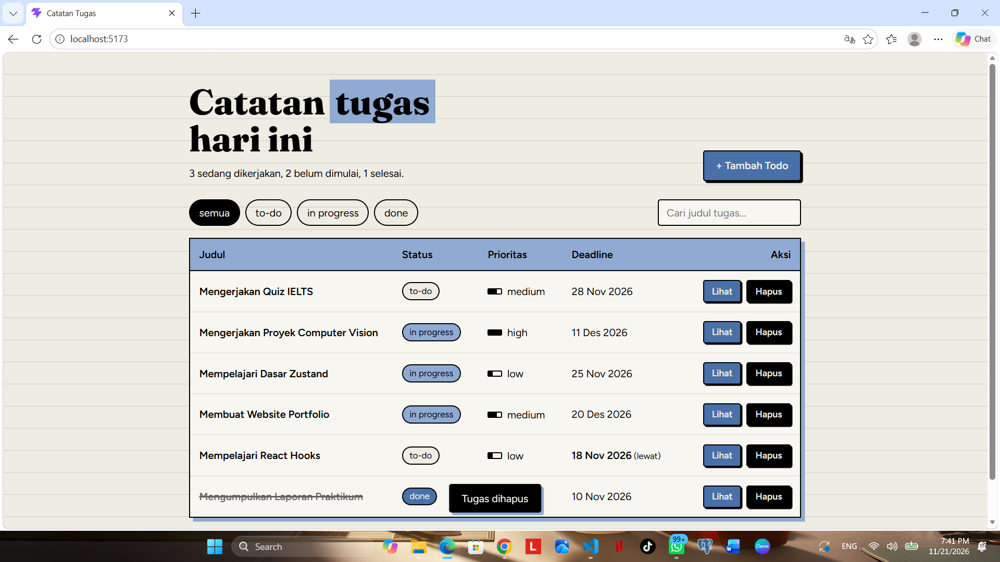

### Pencarian dan tampilan kecil
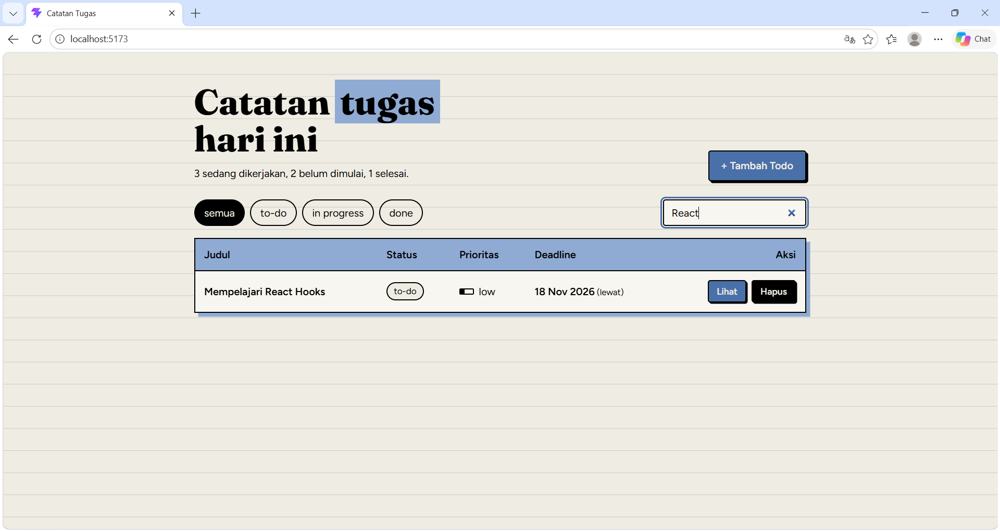


### Detail berdasarkan id
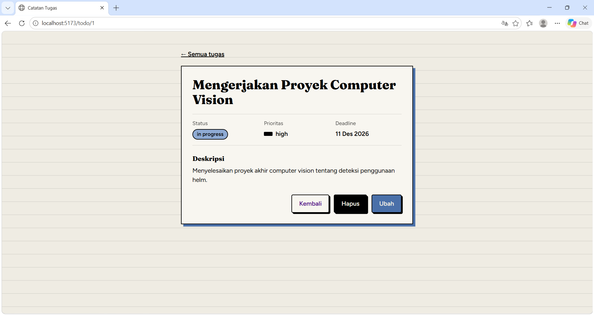
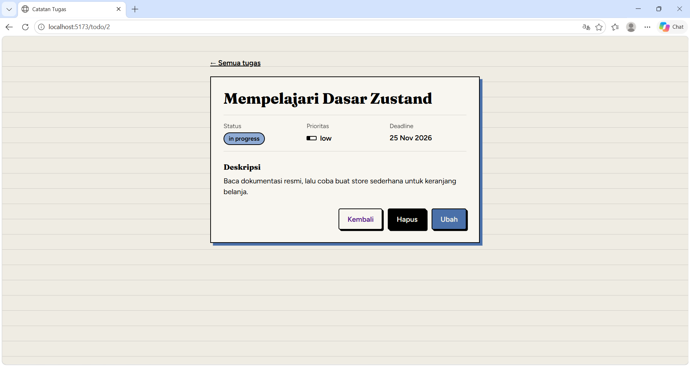
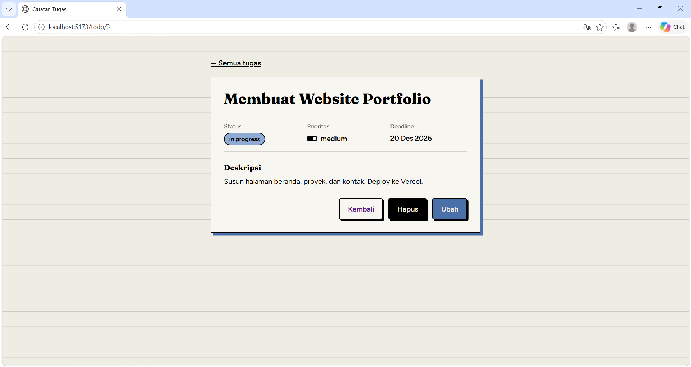
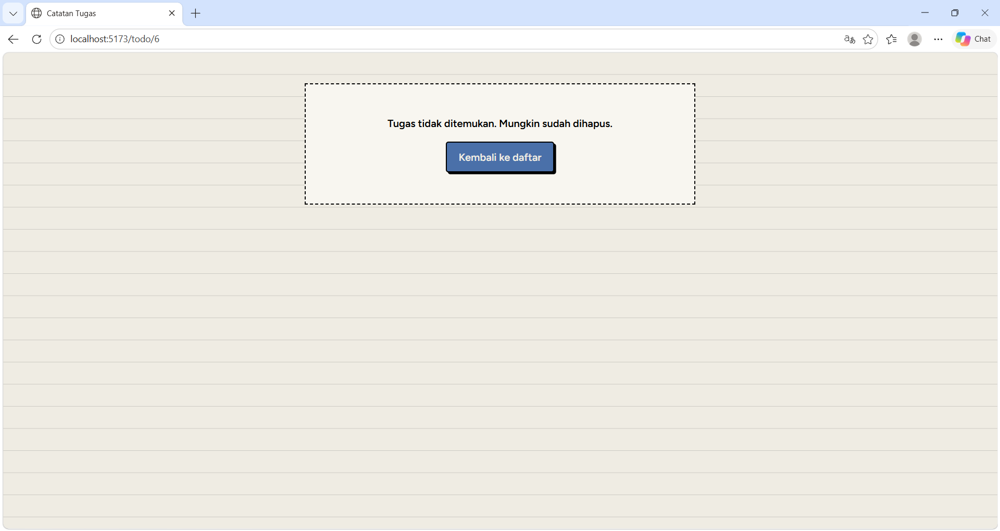